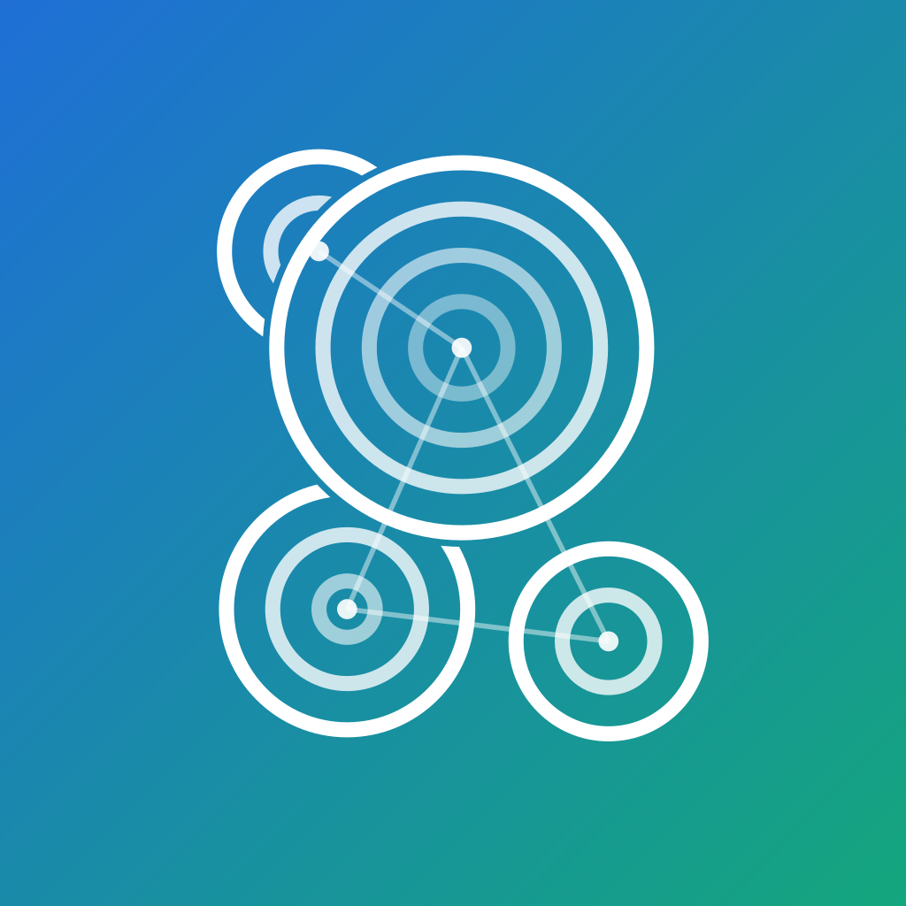

[Readme](README.md) | [Setup](SETUP.md) | [License](LICENSE.md)

# Application RuraLien

<i>Version 0.1-Beta 
**License** 
25/11/2026</i>

*********************************************************************

Merci d'avoir choisi RuraLien ! En utilisant cette application, vous acceptez les termes de la licence ci-dessous. Si vous n'acceptez pas ces termes, veuillez ne pas utiliser ce logiciel.

-----------------------------
Application de communication hors-réseau pour les zones rurales, développé par **Galaxaris**.
Couplé au Module RuraLien, utilisant un boîtier LoRa (ESP32), il permet de créer un réseau local maillé pour communiquer sans dépendre d'Internet (zones blanches, montagne, festivals, camps scouts, situations d'urgence).

-----------------------------
**Veuillez noter**
- Cette application est conçue pour Android avant tout. Des version pourront également être build pour Web, iOS et Desktop (Windows/Mac/Linux).
- Pour plus d'informations sur RuraLien et comment compiler le projet, consultez le fichier [[SETUP.md](DOCUMENTATION.md)].
- Pour plus  d'informations sur Galaxaris et ses autres projets, consultez le site officiel : [https://galaxaris.fr](https://galaxaris.fr)

## License & Autorisation d'Utilisation

CE DOCUMENT VOUS AUTORISE À UTILISER L'APPLICATION RURALIEN (v0.1).

- Ce programme est distribué par l'association Galaxaris. Tous droits réservés. Toute reproduction, duplication ou copie, complète ou partielle, sans l'accord de Galaxaris ou de ses représentants, est strictement interdite. Toute utilisation commerciale ou à but lucratif est également interdite sans autorisation préalable.

## CLAUSE DE NON-RESPONSABILITE

- Ce programme est distribué "tel quel" sans aucune garantie. L'utilisateur assume tous les risques liés à l'utilisation de ce programme, et Galaxaris décline toute responsabilité pour tout dommage résultant de son utilisation.
- EN UTILISANT CE PROGRAMME, VOUS RECONNAISSEZ AVOIR LU CET ACCORD DE LICENCE, LE COMPRENDRE ET ACCEPTER D'ÊTRE LIÉ PAR SES TERMES ET CONDITIONS. SI VOUS N'ACCEPTEZ PAS CES TERMES ET CONDITIONS, N'UTILISEZ PAS CE PROGRAMME.
- AUCUNE GARANTIE : CE PROGRAMME EST FOURNI "TEL QUEL" SANS AUCUNE GARANTIE, EXPLICITE OU IMPLICITE, Y COMPRIS MAIS SANS S'Y LIMITER AUX GARANTIES DE QUALITÉ MARCHANDE, D'ADAPTATION À UN USAGE PARTICULIER ET D'ABSENCE DE CONTREFAÇON. EN AUCUN CAS, GALAXARIS NE POURRA ÊTRE TENUE RESPONSABLE DE TOUT DOMMAGE DIRECT, INDIRECT, ACCESSOIRE OU CONSÉCUTIF (Y COMPRIS MAIS SANS S'Y LIMITER À LA PERTE DE PROFITS, L'INTERRUPTION D'ACTIVITÉ, LA PERTE D'INFORMATIONS OU TOUTE AUTRE PERTE FINANCIÈRE) RÉSULTANT DE L'UTILISATION OU DE L'INCAPACITÉ À UTILISER CE PROGRAMME, MÊME SI GALAXARIS A ÉTÉ INFORMÉE DE LA POSSIBILITÉ DE TELS DOMMAGES.

## Copyright

- _Copyright © 2025-2026 Galaxaris. Tous droits réservés._
- RuraLien n'est en aucun cas affilié à LoRa Alliance, Semtech ou Espressif Systems ou à l'une de leurs filiales ou sociétés affiliées respectives. Les logos et marques de ces sociétés sont la propriété de leurs détenteurs respectifs.
- Tous les autres droits d'auteur et marques sont la propriété de leurs propriétaires respectifs.