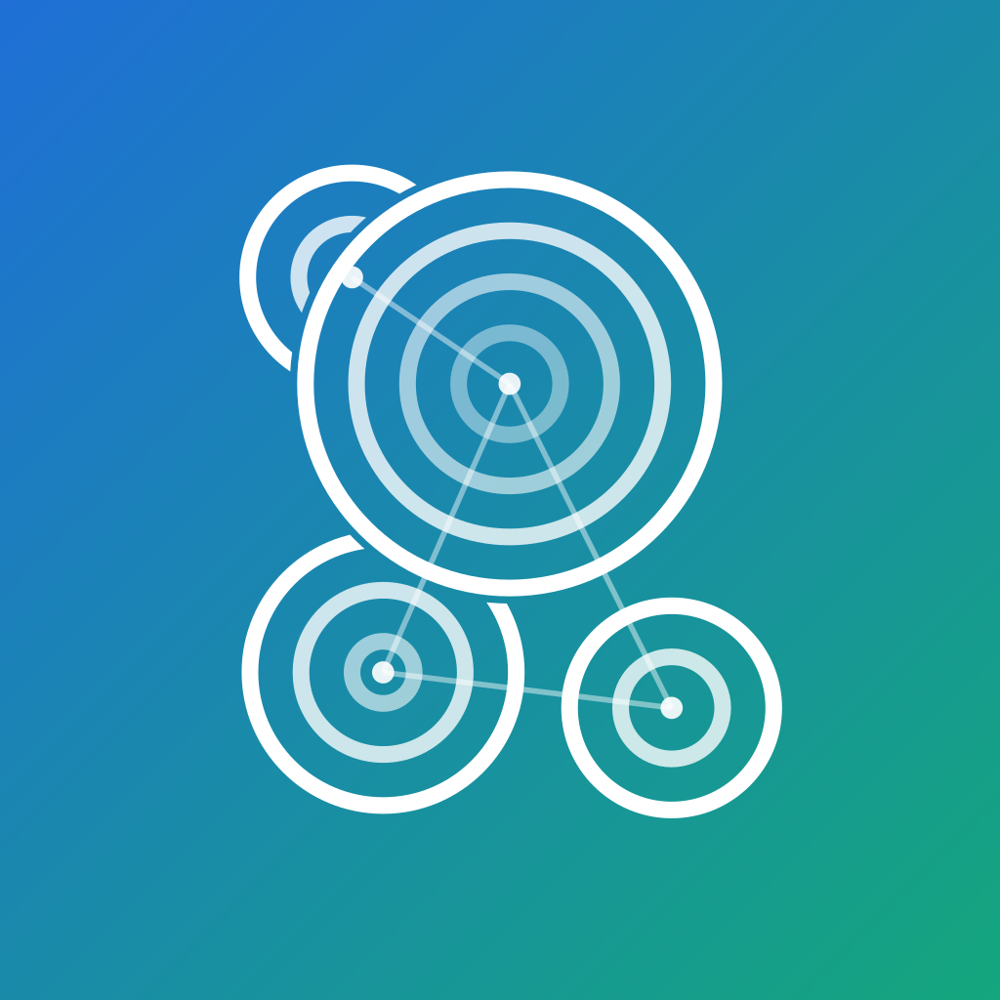

---

# RuraLien

Module de communication pour les habitants des zones rurales, développé par Galaxaris.
Couplé au module Lora, il permet de créer un réseau local pour communiquer entre habitants, sans dépendre d'internet.
Utile pour les zones rurales, les festivals, les camps scouts, ou encore les situations d'urgence.

## Setup de l'environnement sur Windows

* Installer Node.JS (installe aussi npm, qui est inclus dedans) - v26 LTS
* Android Studio : version récente
    * **Settings > Languages & Frameworks > Android SDK** et vérifier qu'un SDK récent est coché (ex: Android API 36 pour Capacitor 8)
    * Un câble USB : pour le debugging direct sur tel Android (activer le debugging USB dans les options de développeurs du tel : Paramètres > About Phone > Sofware Information > tap x5 on "Build Number"\*\* ; Retour à Paramètres, puis Developer options > USB debugging\*\*
* **Extensions VS Code utiles :**
    * ESLint & Prettier (qualité et formatage du code).
    * Tailwind CSS IntelliSense (si vous utilisez Tailwind pour le style, ce que je vous conseille vivement).
    * Vue - Official (si vous choisissez Vue).
* **Extension Firefox utile :** *[Vue.js devtools](https://addons.mozilla.org/en-US/firefox/addon/vue-js-devtools/)*
* Créer un projet ***Vite*** (serveur local et builder pour la prod) :
* On utilise TypeScript (JS augmenté, avec la contrainte des "typages" => c'est trop cool !
* On utilise Vue (voir conv avec Gemini, c'est tellement mieux que React, car bordélique)
* Mais en réalité on peut choisir n'importe quoi qui nous correspond, la commande `npm run build` compilant tout en natif HTML/CSS/JS lisible par le navigateur (pareil avec `npx cap add android` pour Android)

```shell
# 1. Créer l'app web (Vite vous demandera de choisir React ou **Vue**, et JS ou **TypeScript**)
npm create vite@latest mon-projet

# 2. Entrer dans le dossier et installer les dépendances
cd mon-projet
npm install

# 3. Installer Capacitor et la plateforme Android
npm install @capacitor/core @capacitor/android
npm install -D @capacitor/cli

# 4. Initialiser Capacitor
# (Quand il demande "web asset directory", indiquez "dist", c'est le dossier de build de Vite)
npx cap init

# Désactiver la telemetry
npx cap telemetry off

# 5. Compiler le web et générer le projet natif Android
npm run build
npx cap add android
```

***

<br>

* **Lancer le serveur de dev :**

```shell
npm run dev
```

***

<br>

* **Tester sur Android & publier :**

```shell
npm run build          # Compile le site web dans le dossier /distnpx cap sync android   # Copie /dist et les plugins dans le dossier /android
npx cap open android   # Ouvre Android Studio pour lancer sur téléphone ou générer l'AAB
```

*(Astuce : vous pouvez même activer le Live Reload de Capacitor pour voir vos modifications VS Code en direct sur votre téléphone branché en USB).*

--- 

*Copyright (c) 2024 Galaxaris. All rights reserved.*