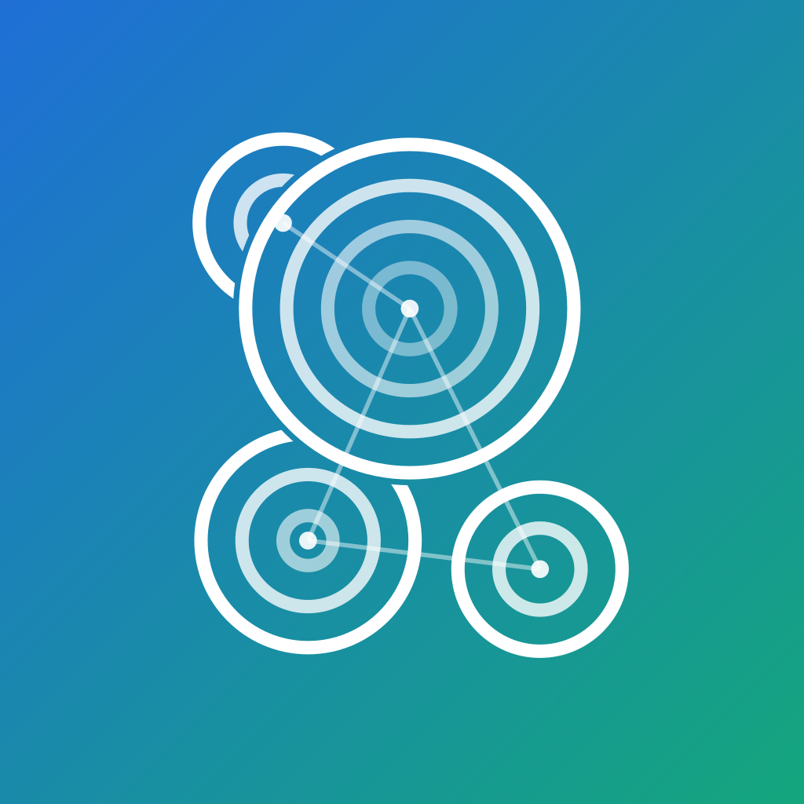

[Readme](README.md) | [Setup](SETUP.md) | [License](LICENSE.md)

---

# Application RuraLien — Guide de Setup & Workflow (Vue 3 + Capacitor)

Application de communication hors-réseau pour les zones rurales, développé par **Galaxaris**.
Couplé au Module RuraLien, utilisant un boîtier LoRa (ESP32), il permet de créer un réseau local maillé pour communiquer sans dépendre d'Internet (zones blanches, montagne, festivals, camps scouts, situations d'urgence).

> **Architecture retenue :** Un **code unique** en **Vue 3 + TypeScript + Vite**, encapsulé dans **Capacitor** pour Android (cible principale) et iOS, déployable tel quel sur le **Web** et empaquetable en logiciel Desktop via **Electron**.

---

## Table des matières
1. [Setup de l'environnement Windows & IDE](#1-setup-de-lenvironnement-windows--ide)
2. [Création du projet (Vite + Vue + Tailwind + Capacitor)](#2-création-du-projet-vite--vue--tailwind--capacitor)
3. [Structure recommandée du projet](#3-structure-recommandée-du-projet)
4. [Configuration d'Android Studio & piège JDK 21](#4-configuration-dandroid-studio--piège-jdk-21)
5. [Workflow quotidien : Dev, Mirroring, Émulateur & Debug](#5-workflow-quotidien--dev-mirroring-émulateur--debug)
6. [Configuration Android (Manifest, Permissions, Deep Links, Icônes)](#6-configuration-android-manifest-permissions-deep-links-icônes)
7. [Stockage local hors-ligne & Différenciation des plateformes](#7-stockage-local-hors-ligne--différenciation-des-plateformes)
8. [Build final : Générer un APK ou AAB (Play Store)](#8-build-final--générer-un-apk-ou-aab-play-store)
9. [Déploiement sur Serveur Web (Apache / PHP)](#9-déploiement-sur-serveur-web-apache--php)
10. [Portabilité iOS (App Store)](#10-portabilité-ios-app-store)
11. [Portabilité Desktop (Windows / Linux / macOS via Electron)](#11-portabilité-desktop-windows--linux--macos-via-electron)

---

## 1. Setup de l'environnement Windows & IDE

### Logiciels à installer
* **Node.js (v26 LTS)** *(inclut `npm`)* : moteur indispensable pour Vite et Capacitor (Capacitor 8 exige Node 22 minimum).
* **VS Code** : éditeur principal (99 % du développement se fait ici).
* **Android Studio** *(version récente, ex : Otter / Quail)* : indispensable pour le SDK Android, l'émulateur et la compilation finale (`.apk` / `.aab`).
  * Après installation, ouvrez **Settings > Languages & Frameworks > Android SDK** et vérifiez qu'un SDK récent est coché (ex : **Android API 36** pour Capacitor 8) ainsi que *Android SDK Build-Tools*.
* **Configurer `JAVA_HOME` (obligatoire pour compiler/Live Reload depuis le terminal VS Code) :**
  1. Ouvrez le menu Démarrer $\rightarrow$ tapez *"variables d'environnement"* $\rightarrow$ **Variables d'environnement...**
  2. Dans **Variables utilisateur**, cliquez sur **Nouvelle...** :
     * Nom : `JAVA_HOME`
     * Valeur : le chemin de votre JDK 21 téléchargé par Android Studio (ex : `C:\Users\<VotreNom>\.jdks\jbr-21.0.11`, **sans** `\bin` à la fin).
  3. Modifiez la variable utilisateur `Path` $\rightarrow$ **Nouveau** $\rightarrow$ ajoutez `%JAVA_HOME%\bin`.
  4. **Redémarrez complètement VS Code**, puis vérifiez dans le terminal :
     ```shell
     java -version   # Doit afficher la version 21
     ```
* **Un câble USB + Smartphone Android** *(fortement recommandé pour RuraLien)* : l'émulateur PC ne gère pas le vrai Bluetooth BLE vers l'ESP32.
  * **Activer le débogage USB :** *Paramètres > À propos du téléphone (About Phone) > Informations logicielles (Software Information)* $\rightarrow$ tapez **7 fois** sur *Numéro de build (Build Number)*. Revenez dans *Paramètres > Options pour les développeurs (Developer options)* $\rightarrow$ activez **Débogage USB (USB debugging)**.

### Extensions recommandées
* **VS Code :**
  * `Vue - Official` *(coloration, autocomplétion et vérification TypeScript pour les `.vue`)*
  * `Tailwind CSS IntelliSense` *(autocomplétion des classes CSS et aperçu des couleurs)*
  * `ESLint` & `Prettier` *(qualité et formatage automatique du code)*
  * *(Optionnel)* `WebNative` *(ajoute une interface graphique dans VS Code pour lancer les commandes Capacitor à la souris)*
    * Couplé à l'application Android *WebNative*, run le projet Web dans VSCode permet de lancer immédiatement l'app projetée sur le Wi-Fi, sur le téléphone (sans recopier l'adresse IP...)
    * Regarder toutes les options disponibles dans le menu **WebNative** dans la barre à gauche de VS Code : ça simplifie énormément de choses !
    * WebNative est pratique, mais jamais indispensable : on peut tout faire autrement (commandes, etc.)
* **Navigateur (Firefox / Chrome) :**
  * *[Vue.js devtools](https://addons.mozilla.org/en-US/firefox/addon/vue-js-devtools/)* *(permet d'inspecter les composants et variables réactives en direct)*

---

## 2. Création du projet (Vite + Vue + Tailwind + Capacitor)

> **À savoir :** `npm run build` compile votre code Vue/TypeScript en pur HTML/CSS/JS standard dans le dossier `dist/`. Ensuite, `npx cap add android` crée le projet natif Android Studio qui embarque ce dossier `dist/` dans une WebView optimisée.

### Étape A : Initialiser Vue + Vite + TypeScript
```shell
# 1. Créer le projet (choisir Framework: Vue, Variant: TypeScript)
npm create vite@latest ruralien

# 2. Entrer dans le dossier et installer les dépendances
cd ruralien
npm install
```

### Étape B : Ajouter Tailwind CSS (v4) et Vue Router
```shell
npm install tailwindcss @tailwindcss/vite vue-router
```

Dans `vite.config.ts`, activez le plugin Tailwind :
```typescript
import { defineConfig } from 'vite'
import vue from '@vitejs/plugin-vue'
import tailwindcss from '@tailwindcss/vite'

export default defineConfig({
  plugins: [vue(), tailwindcss()],
})
```

Dans `src/style.css`, **supprimez tout le CSS par défaut de Vite** et remplacez par :
```css
@import "tailwindcss";

@theme {
  /* Exemple de couleurs personnalisées RuraLien */
  --color-ruralien: #14919B;
  --color-ruralien-dark: #0B5563;
}
```
*(Astuce : si vous préférez écrire du Vanilla CSS isolé dans un composant, utilisez simplement `<style scoped>` dans le fichier `.vue`, sans contrainte).*

### Étape C : Ajouter Capacitor + Plugins de base + Générer Android
```shell
# 1. Installer Capacitor et la plateforme Android
npm install @capacitor/core @capacitor/android
npm install -D @capacitor/cli @capacitor/assets

# 2. Installer les plugins essentiels (cycle de vie, stockage réglages, BDD locale)
npm install @capacitor/app @capacitor/preferences dexie

# 3. Initialiser Capacitor
# (App Name: RuraLien | App ID: com.galaxaris.ruralien | Web asset dir: dist)
npx cap init

# 4. Désactiver la télémétrie Capacitor
npx cap telemetry off

# 5. Compiler le web et générer le projet natif Android
npm run build
npx cap add android
```

### Étape D : Ajouter des raccourcis dans `package.json`
Ajoutez ces scripts dans la section `"scripts"` de `package.json` (l'onglet **NPM Scripts** en bas à gauche de VS Code vous permettra ensuite de tout lancer en un clic) :
```json
"scripts": {
  "dev": "vite",
  "build": "vite build",
  "android:sync": "vite build && npx cap sync android",
  "android:open": "vite build && npx cap sync android && npx cap open android",
  "android:live": "npx cap run android -l"
}
```

---

## 3. Structure recommandée du projet

```text
ruralien/
├── assets/                  # Source logo.png (1024x1024) pour générer les icônes Android/iOS
├── public/                  # Fichiers copiés TEL QUEL à la racine de dist/ (sans traitement)
│   └── .htaccess            # Règles Apache pour Vue Router (ignoré automatiquement par Android)
├── src/
│   ├── assets/              # Images/SVG utilisés dans le code (hero.png...)
│   ├── components/          # Briques UI réutilisables (SosButton.vue, ModalCard.vue...)
│   ├── views/               # Pages complètes gérées par Vue Router (ChatView.vue, OnboardingView.vue...)
│   ├── router/              # Configuration des routes (index.ts)
│   ├── services/            # Logique métier : BLE ESP32, Web Serial, IndexedDB (db.ts)...
│   ├── stores/              # État global partagé (ex: Pinia : connexion boîtier, réseau actif)
│   ├── style.css            # Point d'entrée Tailwind / CSS global
│   ├── App.vue              # Squelette principal (<RouterView />)
│   └── main.ts              # Point d'entrée JS/TS
├── android/                 # Projet natif Android Studio (À versionner sur Git !)
│   └── app/src/main/assets/public/  # ⚠️ ZONE INTERDITE : écrasée à chaque "cap sync"
├── capacitor.config.ts      # Configuration centrale Capacitor
├── vite.config.ts           # Configuration Vite
└── package.json             # Dépendances et scripts
```

> **⚠️ Règle cruciale sur `npx cap sync android` :**
> `cap sync` **N'ÉCRASE PAS** vos réglages dans `AndroidManifest.xml`, `strings.xml` ou `app/build.gradle`. Il ne remplace que `android/app/src/main/assets/public/` (votre build `dist/`) et la liste auto-générée des plugins (`capacitor.build.gradle`). Ne modifiez jamais rien à la main dans `assets/public/`.

---

## 4. Configuration d'Android Studio & Piège JDK 21

1. Ouvrez Android Studio depuis VS Code :
   ```shell
   npx cap open android
   ```
2. **Patience au premier lancement :** Attendez que la barre **"Gradle sync..."** tout en bas à droite se termine complètement (1 à 5 min). Tant que ça charge, le bouton **▶ Run** reste grisé sur *"Add Configuration"*.

> **⚠️ PIÈGE FRÉQUENT (JDK 25 vs JDK 21) :**
> Les versions récentes d'Android Studio embarquent Java 25 par défaut, alors que Gradle 8.14 (Capacitor 8) exige **Java 21** (ou <= 24). Si vous voyez `Incompatible Gradle JVM version... currently selected 25` (et que le bouton automatique *"Apply compatible Gradle JDK..."* tourne en boucle) :
> 1. Allez manuellement dans **File > Settings > Build, Execution, Deployment > Build Tools > Gradle**.
> 2. Dans **Gradle JDK**, cliquez sur **Download JDK...** $\rightarrow$ choisissez **Version 21** (Temurin ou JetBrains Runtime) et téléchargez-le.
> 3. Vérifiez que le menu déroulant **Gradle JDK** pointe bien sur ce **21** (et NON sur `jbr-25` ou `GRADLE_LOCAL_JAVA_HOME`), cliquez sur **Apply** puis **OK**.
> 4. Si Gradle reste bloqué en cache sur la 25 :
>    * Ouvrez le terminal en bas d'Android Studio et exécutez `.\gradlew --stop`.
>    * Vérifiez si un fichier `android/gradle/gradle-daemon-jvm.properties` contient `25` (passez-le à `21` ou supprimez-le).
>    * Solution ultime : dans `C:\Users\<VotreNom>\.gradle\gradle.properties`, ajoutez `org.gradle.java.home=C:\\Users\\<VotreNom>\\.jdks\\<DossierJDK21>`.
> 5. Cliquez sur l'icône **éléphant avec flèche bleue** en haut à droite (*Sync Project with Gradle Files*). Dès que la synchro réussit, **`app`** apparaît et le bouton **▶** devient vert !

---

## 5. Workflow quotidien : Dev, Mirroring, Émulateur & Debug

### 1. Développement rapide de l'interface (90 % du temps)
Lancez le serveur local Vite avec rechargement instantané et ouvrez `http://localhost:5173` dans Chrome/Firefox (avec la vue mobile `F12`) :
```shell
npm run dev
```

### 2. Déployer & tester sur Android (téléphone USB ou Émulateur)
* **Build classique vers Android Studio :**
  ```shell
  npm run build          # Compile Vue dans /dist
  npx cap sync android   # Copie /dist et met à jour les plugins dans /android
  npx cap open android   # Ouvre Android Studio -> cliquez sur ▶ Run 'app'
  ```
* **Mode Live Reload sur téléphone USB (debug temps réel sans rebuild) :**
  1. Vérifiez que `vite.config.ts` contient bien `server: { host: true }` dans `defineConfig(...)`.
  2. **Terminal 1** — Lancez le serveur de dev et notez l'IP réseau affichée (`Network: http://192.168.X.X:5173`) :
     ```shell
     npm run dev
     ```
  3. **Terminal 2** — Lancez l'app sur le téléphone en remplaçant par **votre** IP (nécessite `JAVA_HOME` configuré sur JDK 21) :
     ```shell
     npx cap run android -l --host=192.168.X.X --port=5173
     ```
     *(Vous pouvez aussi simplement lancer `npx cap run android -l --port=5173` pour choisir votre IP dans la liste).*

  *(Note : nécessite que le PC et le téléphone soient sur le même réseau Wi-Fi, et que le pare-feu Windows autorise le port 5173).*

  > **Astuce si le Wi-Fi bloque (réseau d'école / pare-feu Windows) :** Passez 100 % par le câble USB sans Wi-Fi :
  > 1. Redirigez le port via ADB : `C:\Users\%USERNAME%\AppData\Local\Android\Sdk\platform-tools\adb.exe reverse tcp:5173 tcp:5173`
  > 2. Lancez : `npx cap run android -l --host=127.0.0.1 --port=5173`

### 3. Émulateur & Mirroring d'écran
* **Émulateur intégré :** Dans Android Studio, panneau de droite **Device Manager** $\rightarrow$ **+ Create Virtual Device** (utile pour tester plusieurs tailles d'écran UI, mais pas pour le Bluetooth BLE).
* **Mirroring d'un vrai téléphone sur l'écran du PC :**
  * Option intégrée : Dans Android Studio, ouvrez l'onglet **Running Devices** (panneau de droite) pour afficher et contrôler l'écran de votre téléphone branché en USB.
  * Option ultra-fluide : Utilisez **[scrcpy](https://github.com/Genymobile/scrcpy)** (gratuit, léger, contrôle clavier/souris parfait pour vos présentations).

### 4. Inspecter les bugs (Console & Logs)
* **Logs natifs Android / Plugins :** Onglet **Logcat** tout en bas d'Android Studio.
* **Console WebView en direct (`chrome://inspect`) :** Pendant que l'appli tourne sur le téléphone en USB, ouvrez Google Chrome sur Windows et tapez **`chrome://inspect/#devices`**. Cliquez sur **inspect** sous votre application RuraLien pour obtenir toute la DevTools Chrome (Console JS, CSS, réseau, IndexedDB) en direct sur le téléphone !

---

## 6. Configuration Android (Manifest, Permissions, Deep Links, Icônes)

### A. Nom de l'app et Versions
* **Nom affiché sous l'icône :** modifiez `app_name` dans `android/app/src/main/res/values/strings.xml`.
* **Numéro de version (Play Store) :** modifiez `versionCode` (entier incrémenté à chaque envoi : `1`, `2`, `3`...) et `versionName` (`"1.0.0"`) dans `android/app/build.gradle`.
* **Versions Android cibles :** dans `android/variables.gradle` (`minSdkVersion = 24` pour Android 7+, `compileSdkVersion = 36`, `targetSdkVersion = 36`).

### B. Permissions natives (`android/app/src/main/AndroidManifest.xml`)
À ajouter au-dessus de la balise `<application>` selon vos besoins :
```xml
<!-- Caméra (Scan QR Code réseau/boîtier) -->
<uses-permission android:name="android.permission.CAMERA" />

<!-- Bluetooth BLE (Android 12+ / API 31+) -->
<uses-permission android:name="android.permission.BLUETOOTH_SCAN" android:usesPermissionFlags="neverForLocation" />
<uses-permission android:name="android.permission.BLUETOOTH_CONNECT" />

<!-- Bluetooth BLE (Android 11 et inférieurs) -->
<uses-permission android:name="android.permission.BLUETOOTH" android:maxSdkVersion="30" />
<uses-permission android:name="android.permission.BLUETOOTH_ADMIN" android:maxSdkVersion="30" />
<uses-permission android:name="android.permission.ACCESS_FINE_LOCATION" android:maxSdkVersion="30" />
```

### C. Affichage plein écran Edge-to-Edge (Android 15/16)
Capacitor 8 active par défaut l'affichage bord-à-bord sous la barre de statut et la barre de navigation. Dans votre CSS principal Vue, protégez votre interface avec les marges système sûres :
```css
.app-shell {
  padding-top: env(safe-area-inset-top);
  padding-bottom: env(safe-area-inset-bottom);
}
```

### D. Icône de l'application & Splash Screen (Automatique)
1. Placez une image carrée `logo.png` (1024×1024 px) dans le dossier `assets/` à la racine du projet.
2. Lancez :
   ```shell
   npx @capacitor/assets generate --android --iconBackgroundColor '#14919B' --splashBackgroundColor '#14919B'
   ```

### E. Liens Profonds / Deep Links (ex : `https://ruralien.app/r/BP-4F7K`)
Permet d'ouvrir directement l'app sur la bonne page quand on clique sur un lien d'invitation :
1. **Dans `android/app/src/main/AndroidManifest.xml`** (à l'intérieur de `<activity android:name=".MainActivity">`) :
   ```xml
   <intent-filter android:autoVerify="true">
     <action android:name="android.intent.action.VIEW" />
     <category android:name="android.intent.category.DEFAULT" />
     <category android:name="android.intent.category.BROWSABLE" />
     <data android:scheme="https" android:host="ruralien.app" android:pathPrefix="/r/" />
   </intent-filter>
   ```
   *(Astuce de test hors-ligne/sans domaine : utilisez un schéma personnalisé `android:scheme="ruralien"` pour tester `ruralien://r/BP-4F7K` sans serveur).*
2. **Sur votre serveur Web :** publiez le fichier `https://ruralien.app/.well-known/assetlinks.json` contenant le package ID et l'empreinte SHA-256 de votre clé de signature Android.
3. **Dans votre code Vue (`src/App.vue`) :**
   ```typescript
   import { App } from '@capacitor/app'
   import { useRouter } from 'vue-router'

   const router = useRouter()

   App.addListener('appUrlOpen', (event) => {
     const path = new URL(event.url).pathname
     if (path) router.push(path)
   })
   ```
   *(Bonus Android : écoutez aussi `App.addListener('backButton', ...)` pour relier le bouton Retour du téléphone à `router.back()`).*

---

## 7. Stockage local hors-ligne & Différenciation des plateformes

### Règle de stockage (Offline-First)
> **N'utilisez pas `localStorage` pour les données importantes** (limité à ~5 Mo, synchrone et susceptible d'être effacé par iOS/Android en cas de manque de place).
* **`@capacitor/preferences`** : petits réglages persistants (ID du boîtier BLE appairé, pseudo, préférences).
* **`IndexedDB` (via `Dexie.js`)** : stockage de l'historique des messages LoRa, canaux, membres et futures cartes hors-ligne (plusieurs centaines de Mo/Go, fonctionne **identiquement** sur Android, iOS, Web et Electron).
* **`@capacitor/filesystem`** : lecture/écriture de vrais fichiers locaux (exports de logs SOS, sauvegardes JSON).

### Différencier les plateformes (équivalent `#if ... #endif` de Unity)
* **À l'exécution (Runtime — 95 % des cas) :**
  ```typescript
  import { Capacitor } from '@capacitor/core'

  if (Capacitor.getPlatform() === 'android') {
    // Logique mobile (BLE Capacitor, USB OTG...)
  } else if (Capacitor.getPlatform() === 'web') {
    // Logique navigateur / PC (Web Serial API, Web Bluetooth...)
  }
  ```
* **À la compilation (suppression de code mort comme `#if`) :**
  Lancez `vite build --mode android` ou `vite build --mode web`, et testez `if (import.meta.env.MODE === 'android') { ... }` : Vite supprimera physiquement les blocs inutilisés lors du build.

---

## 8. Build final : Générer un APK ou AAB (Play Store)

1. Synchronisez une dernière fois votre dernier code Vue :
   ```shell
   npm run build
   npx cap sync android
   npx cap open android
   ```
2. **Pour un `.apk` de test** (à partager en direct à l'équipe / jury) :
   * Dans Android Studio : **Build > Build App(s) / APK(s) > Build APK(s)**.
   * Récupérez le fichier dans `android/app/build/outputs/apk/debug/app-debug.apk`.
3. **Pour le Google Play Store (`.aab` signé obligatoire)** :
   * Menu **Build > Generate Signed App Bundle / APK...** $\rightarrow$ choisissez **Android App Bundle**.
   * Créez ou sélectionnez votre clé de signature (`.jks` / `.keystore`).
   * Choisissez la variante **release**.

> **⚠️ SÉCURITÉ CRITIQUE :**
> Ne mettez **JAMAIS** votre fichier `.jks` / `.keystore` ni vos mots de passe sur Git ! Ajoutez `*.jks` et `*.keystore` dans votre `.gitignore`, et faites-en une sauvegarde sécurisée (si vous perdez cette clé, vous ne pourrez plus jamais mettre à jour l'appli sur le Play Store).

---

## 9. Déploiement sur Serveur Web (Apache / PHP)

1. **Gérez les routes Vue Router sur Apache :**
   Créez le fichier `public/.htaccess` (il sera copié automatiquement dans `dist/` lors du build) :
   ```apache
   <IfModule mod_rewrite.c>
     RewriteEngine On
     RewriteBase /
     RewriteCond %{REQUEST_FILENAME} !-f
     RewriteCond %{REQUEST_FILENAME} !-d
     RewriteRule ^ index.html [L]
   </IfModule>
   ```
   *(Les vrais fichiers/dossiers comme un éventuel dossier `/api` en PHP ou `/.well-known/assetlinks.json` continuent d'être servis normalement).*
2. **Compilez le site :**
   ```shell
   npm run build
   ```
3. **Déployez :** Uploadez **tout le contenu** du dossier `dist/` à la racine de votre hébergement web (en **HTTPS obligatoire**, car Chrome/Edge bloquent `Web Bluetooth`, `Web Serial`, la géolocalisation et les PWA en HTTP non sécurisé).

---

## 10. Portabilité iOS (App Store)

> **Prérequis obligatoire :** Un **Mac** avec **Xcode** installé (Apple interdit la compilation iOS depuis Windows) et un compte Apple Developer (99 $/an pour l'App Store, gratuit pour tester sur son propre iPhone par câble).

1. Sur le Mac, clonez le dépôt Git et installez les dépendances :
   ```shell
   npm install
   npm install @capacitor/ios
   npm run build
   npx cap add ios
   npx cap open ios
   ```
2. **Icônes & Splash Screen iOS :**
   ```shell
   npx @capacitor/assets generate --ios
   ```
3. **Permissions obligatoires dans `ios/App/App/Info.plist`** (sinon crash immédiat à l'appel du Bluetooth ou de la Caméra) :
   * `NSBluetoothAlwaysUsageDescription` *(ex : "Connexion au boîtier RuraLien LoRa")*
   * `NSCameraUsageDescription` *(ex : "Scanner le QR Code d'un réseau")*
4. Dans **Xcode**, sélectionnez votre équipe de signature (*Signing & Capabilities*), branchez l'iPhone ou choisissez un simulateur, puis **▶ Run** (ou **Product > Archive** pour envoyer sur TestFlight / App Store).
5. À chaque mise à jour du code Vue : `npm run build && npx cap sync ios`.

---

## 11. Portabilité Desktop (Windows / Linux / macOS via Electron)

Pour transformer votre dossier `dist/` en véritable logiciel `.exe` / `.AppImage` / `.dmg` (utile par exemple pour un poste de secours ou une caserne relié en USB-C au boîtier RuraLien) :

> **Note :** Bien qu'il existe un plugin communautaire (`@capacitor-community/electron`), il est souvent en retard sur les versions majeures de Capacitor. Encapsuler directement votre dossier `dist/` dans un wrapper **Electron** propre est plus fiable et maintenable.

### Setup rapide d'un wrapper Electron autour de `dist/`
1. Installez Electron et le packager en dépendances de développement :
   ```shell
   npm install -D electron electron-builder
   ```
2. Dans `src/router/index.ts`, utilisez `createWebHashHistory()` lorsque vous êtes dans Electron (car Electron charge `dist/index.html` via le protocole `file://`).
3. Créez un fichier `electron/main.cjs` à la racine :
   ```javascript
   const { app, BrowserWindow } = require('electron')
   const path = require('path')

   function createWindow() {
     const win = new BrowserWindow({
       width: 1100,
       height: 750,
       webPreferences: {
         contextIsolation: true
       }
     })

     // En dev : win.loadURL('http://localhost:5173')
     win.loadFile(path.join(__dirname, '../dist/index.html'))
   }

   app.whenReady().then(createWindow)
   app.on('window-all-closed', () => {
     if (process.platform !== 'darwin') app.quit()
   })
   ```
   *(Astuce : dans Electron, vous pouvez aussi autoriser `session.defaultSession.setPermissionCheckHandler` / `select-serial-port` pour utiliser directement la **Web Serial API** vers le boîtier ESP32 branché en USB sur PC).*
4. Ajoutez dans `package.json` :
   ```json
   "main": "electron/main.cjs",
   "scripts": {
     "electron:start": "vite build && electron .",
     "electron:build": "vite build && electron-builder"
   }
   ```
   *(Important : pour Electron avec `loadFile`, ajoutez `base: './'` dans `vite.config.ts` afin que les chemins des scripts JS/CSS soient relatifs).*

---

*Copyright (c) 2025-2026 Galaxaris. Tous droits réservés.*